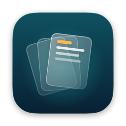

# Mneme



A light, native clipboard manager for the Mac. Everything you copy, one shortcut away: a shelf of cards at the
bottom of the screen with search (including the text inside images), pinboards, a paste stack, themes, and every
shortcut changeable. About 22 MB of memory when idle.

## Use

- **⇧⌘V** opens the shelf over any app. Type to search, ← → to move, **Return** pastes into the app you were in
  (⇧Return as plain text), **⌘1** to **⌘9** paste one of the first nine, **Tab** and **⇧Tab** switch between History and your pinboards,
  **Esc** closes.
- On a card: **Space** preview, **⌘E** edit (text in place, keeping formatting; images open in Preview and the card
  updates when you save), **⌘C** copy, **⌫** remove from History (or from the pinboard you are in), **⌘⌫** delete
  everywhere, **⌘R** rename, **⌘N** new pinboard. Right-click for the same plus **Pin to**. Drag a card out into any
  app; drag cards to reorder them inside a pinboard.
- **Paste stack:** **⇧⌘C**, copy several things, then press **⌘V** for each: they paste in the order copied. A small
  panel shows the order; drag to reorder, ✕ to remove.
- **Formatting that suits where you paste:** when an app comes to the front, on ⌘V, and on pastes from the shelf or
  the paste stack, a text copy is put in the form for the app, or the site in a browser, in front (so Edit > Paste
  and a right click get it too): spreadsheets get it as copied, mail, documents and chat apps get its
  structure without the source's colours and fonts, code editors (and the AI chat boxes in them) get
  Markdown, with bold, numbered lists and tables written out, terminals (VS Code's and Cursor's built-in one too)
  get text with no Markdown, bullets or indents, and plain-text chats get `•` bullets. Markdown-looking plain text, and rich text from Word, Pages, TextEdit or Notes,
  becomes clean formatted text where formatting is taken.
  ⌥⇧⌘V pastes plain text and ⌃⌥⌘V the original anywhere (⇧↩ and ⌥↩ in the shelf); choosing the same way twice for
  one place makes it the rule there. Settings → Pasting; a content-free log of pastes is kept in `paste-log.jsonl`.
- **Sound:** a soft sound when a copy is saved and another when Mneme pastes. Settings → Sound picks each sound and
  their loudness; by default they stay at the same loudness whatever your Mac's volume.
- Every shortcut can be changed in Settings → Shortcuts (menu bar icon → Settings…, or the gear in the shelf).

## Permissions

| Permission | Why | Without it |
| --- | --- | --- |
| Paste from Other Apps (macOS 15.4+) | Reading what you copy | Nothing is saved; the shelf says "Capture is off" |
| Accessibility | Pressing ⌘V for you; ⌘V in the paste stack | Picking an item copies it and you press ⌘V |

Both are asked for once, in the first-launch setup, and never again. Choose **Always Allow** for clipboard access:
"Allow Paste" only allows a single read. The app is signed against its bundle id (`local.mneme`), so permissions
survive rebuilds.

## Privacy

- Secrets that password managers mark (`org.nspasteboard.ConcealedType`) are never read or saved.
- Nothing copied in 1Password, Keychain Access or Passwords is saved (edit the list in Settings → Privacy).
- The only network use is link previews (the start of a copied link's page, no cookies); turn it off in
  Settings → Privacy. No telemetry.

## Updates

Mneme keeps itself up to date from `https://updates.riddlelab.dev/mneme/update.json`, served from our own server (no
GitHub releases). At launch and every six hours it reads `update.json`, downloads a newer version, checks its size,
SHA-256 and Ed25519 signature against the release key built into the app, unpacks it, checks the app inside (bundle
id, version, code signature), then swaps it in and reopens: on its own while the shelf is closed and the paste stack
is off, or from the menu ("Restart to Update to …") when Settings → General → Install updates automatically is off.
Permissions carry over: the app is signed with a requirement on its bundle id, not on each build. Copies older than
0.4 do not update themselves; install 0.4 once by hand.

Mneme must run from a folder it can write to (`~/Applications` or `/Applications`), not straight from Downloads.

## Releasing

```sh
Kit/scripts/release --dry-run 0.5 "What changed"   # build, sign and show the manifest; nothing leaves the Mac
Kit/scripts/release 0.5 "What changed, in a sentence or two"
```

It sets the version, runs the tests, builds, zips and signs on this Mac, uploads to homelab, swaps `update.json` in
last, then commits, tags `v0.5` and pushes. Every copy of Mneme finds it within six hours. The updater, the release
command and the key handling live in the shared kit (`Kit/`, [polycurio/kit](https://github.com/polycurio/kit)).

The release key: the public half is `UpdateApp.releaseKey` in `Kit/Core/Update.swift`; the private half is at
`~/.config/polycurio/update-signing-key` (never commit it). Without it no update can be signed.

## Where things are

- History: `~/Library/Application Support/Mneme/` (`mneme.sqlite`, `Blobs/`, `Thumbs/`).
- Settings: `defaults read local.mneme`.
- Images being edited in Preview: `~/Library/Caches/local.mneme/Edits/`.
- Downloaded updates waiting to be installed: `~/Library/Caches/local.mneme/Update/`.

## Build

Needs the Command Line Tools only (no Xcode, no SwiftPM).

```sh
./build.sh            # build/Mneme.app
./build.sh test       # unit tests (optional name filter: ./build.sh test Capture)
./build.sh install    # build and copy to ~/Applications/Mneme.app
```

Clone with `git clone --recurse-submodules` (or run `git submodule update --init` once) to get `Kit/`.

Development helpers (they never touch your real history):

```sh
./build/tests --fixture build/fixtures/normal normal   # made-up stores: normal, long, many (10,000), empty
scripts/snapshots.sh                                    # every shelf state as PNGs, drawn off screen
scripts/measure.sh 20 60                                # open speed and idle memory on 10,000 items
build/Mneme.app/Contents/MacOS/Mneme --store build/fixtures/many --scroll 240   # scrolling frame times
```

`docs/design.md` is the design, `docs/plan.md` the build plan, `docs/spike-notes.md` what was measured and found.
The icon is drawn in code: `swiftc -O -o build/make_icon scripts/make_icon.swift && build/make_icon &&
iconutil -c icns build/AppIcon.iconset -o Resources/AppIcon.icns`.
